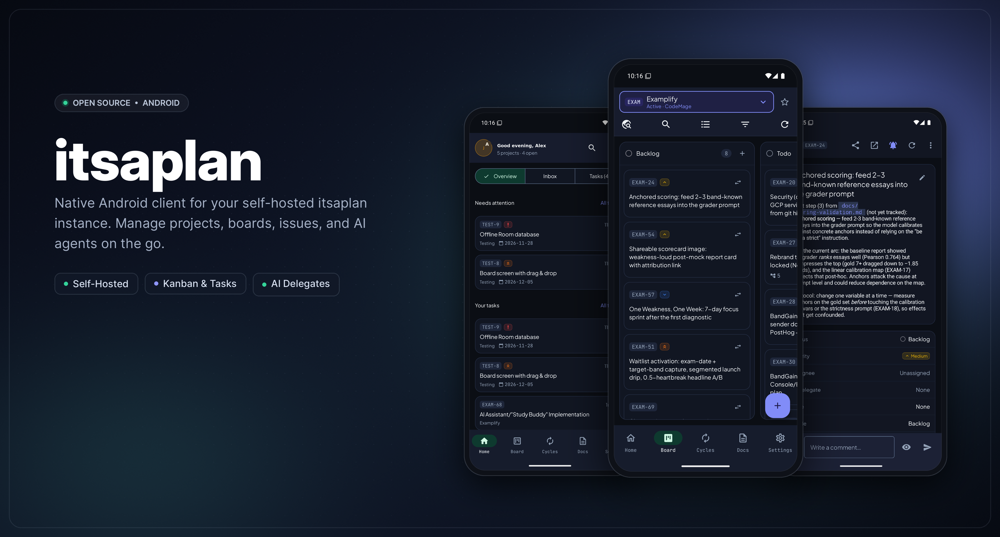
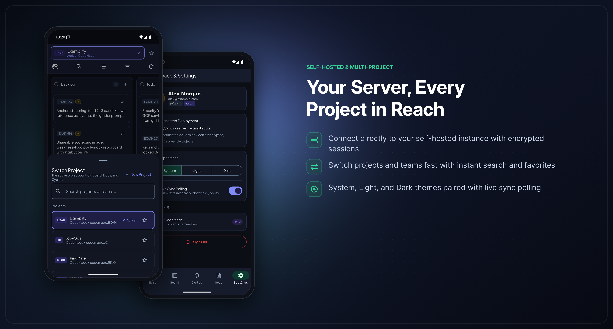
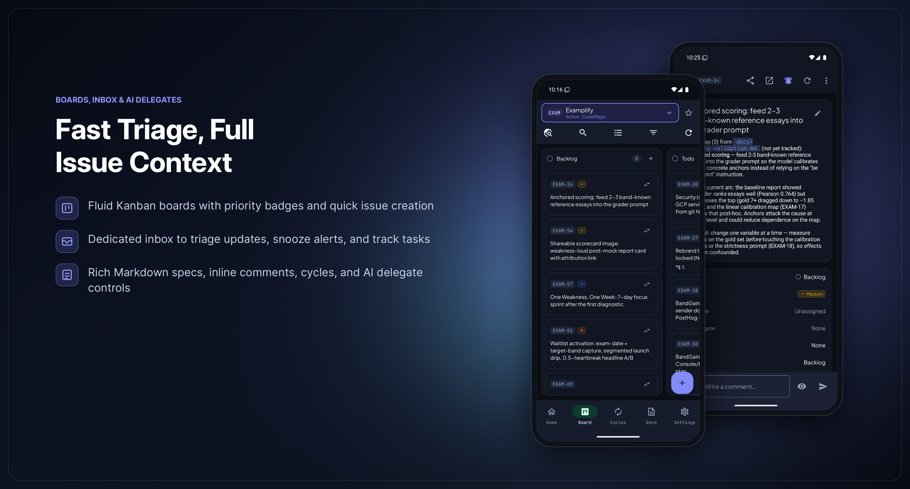

# It's a Plan — Android

An unofficial native Android client for [It's a Plan](https://github.com/croffasia/itsaplan),
a self-hosted, open-source project management and issue tracker. This app talks directly to
your own self-hosted It's a Plan API over its public REST API — no third-party servers, no
telemetry, and no dependency on the official web client.

Built with Kotlin and Jetpack Compose, targeting modern Android devices including book-style
foldables (unfolded two-pane layouts on wide screens).

> **Status:** personal project, works against a real self-hosted instance. Expect rough edges.
> Not affiliated with or endorsed by the It's a Plan project or its maintainers.

<p align="center">
  
</p>

## Features

- **Board** — Kanban and grouped-list views of a project's issues, long-press drag-and-drop
  between Kanban columns, a quick-move status sheet, filters (priority, assignee, label, cycle),
  search, quick issue creation, and a recent-issues strip for jumping back into work.
- **Issue detail** — markdown-rendered description and comments, metadata editing (status,
  priority, assignee, AI delegate, type, cycle, due date, estimates), labels, custom fields,
  checklists, subtasks, linked issues, attachments (photo/file picker), time tracking (worklogs),
  watch/unwatch, archive/restore/delete, AI agent run history, and linked **pull requests /
  branches** from connected Git providers (GitHub, GitLab, Gitea, Forgejo, Bitbucket), plus
  tappable image previews with a pinch-to-zoom full-screen viewer.
- **Activity & comments** — threaded comments with replies, emoji reactions, edit/delete,
  autosaved drafts, and a combined activity feed (comments, history, time logs) with filtering.
- **My Issues** — cross-project view of issues assigned to or delegated to you, plus a home-screen
  widget showing your open issues.
- **Global search** — search issues across all accessible projects from the Board tab.
- **Inbox** — notifications (assignments, mentions, comments, state changes, reactions) with
  read/unread, snooze, and type filtering. Comment notifications deep-link to and highlight the
  relevant comment.
- **Cycles** — sprint-style time-boxed iterations: create, view progress, finish, start the next
  cycle, and transfer unfinished issues.
- **Docs** — browse a project's document tree, read rendered Markdown, and create/edit pages with
  autosaved drafts.
- **Sharing** — share issue/document links or open them in a browser.
- **Live sync** — lightweight polling against the server's revision endpoint to refresh the
  board and inbox when something changes elsewhere, without a heavy real-time connection.
- **Responsive layout** — single-pane navigation bar on compact widths (phones, folded cover
  screens); navigation rail plus a list/detail split pane on medium/expanded widths (tablets,
  unfolded book-style foldables), with width-capped reading columns so text doesn't stretch
  edge-to-edge on near-square unfolded displays.
- **Flexible auth** — sign in with a personal API key or with email/username + password
  (session cookie), against any HTTPS server URL you control (see
  [Connecting to a local-only instance](#connecting-to-a-local-only-instance)).

## Screenshots

<p align="center">
  
</p>

<p align="center">
  
  
</p>

Real captures of every screen, in light and dark mode at phone width, live in
[`screenshots/`](screenshots/) and can be regenerated with
[`screenshots/capture.sh`](screenshots/capture.sh).

## Requirements

- An existing, reachable **self-hosted It's a Plan instance** (see the
  [official project](https://github.com/croffasia/itsaplan) for deployment instructions). This
  app is a client only; it does not host or manage a server.
- A **personal API key** (Account settings → API keys on your instance) or a regular
  email/username + password login.
- Android 7.0 (API 24) or newer.

## Getting started

1. Clone this repository.
2. Open it in Android Studio (or build from the command line with Gradle — see below).
3. Build and install the app on a device or emulator.
4. On first launch, enter your It's a Plan server URL (e.g. `https://itsaplan.example.com`) and
   sign in with either a personal API key or your account credentials.

### Building

```bash
./gradlew assembleDebug
```

> This repository currently ships without a committed Gradle wrapper JAR. If `./gradlew` is not
> present, generate one locally with a matching Gradle installation (`gradle wrapper`) before
> building, or open the project in Android Studio, which bootstraps the wrapper automatically.

### Configuration

No build-time configuration is required to connect to a server — the server URL is entered at
runtime on the connect screen and stored locally on the device (see
[Local storage](#local-storage--privacy) below). `.env.example` only documents an optional
`GEMINI_API_KEY` placeholder inherited from the AI Studio scaffold this project started from; it
is unused by the app's core functionality and can be ignored.

### Connecting to a local-only instance

The app refuses plain HTTP for anything except the loopback and emulator hosts, because the
request carries your API key or session cookie:

| Address | Allowed |
| --- | --- |
| `https://…` | Yes, any host |
| `http://localhost`, `http://127.0.0.1`, `http://10.0.2.2` | Yes — local development and the Android emulator |
| `http://192.168.x.x`, `http://10.x.x.x`, any other `http://` | No |

That means a LAN-only instance served over plain HTTP, such as `http://192.168.1.5:3000`, is
rejected on purpose. Your options are:

1. **Give it TLS** (recommended). Put the instance behind a reverse proxy with a trusted
   certificate — Caddy, Traefik and nginx all obtain Let's Encrypt certificates automatically if
   the host is reachable from the internet, including through a dynamic-DNS name.
2. **Use a tunnel.** Cloudflare Tunnel, Tailscale Serve or ngrok expose the LAN instance on an
   `https://` address without opening a port or changing the server.
3. **Build your own APK** with a wider allowlist. Two places must agree:
   - `ApiClientManager.isLocalDevelopmentHost()` in
     `app/src/main/java/com/example/data/remote/ApiClientManager.kt`, which decides what the app
     will connect to;
   - `app/src/main/res/xml/network_security_config.xml`, which decides what Android permits. Add
     a `<domain>` entry per host — the platform config has no CIDR support, so private ranges
     have to be listed individually.

Self-signed certificates are not trusted today: the app trusts the system CA store only, and
Android does not treat user-installed CAs as system CAs from API 24 onward. A self-signed
instance therefore needs either a publicly trusted certificate (options 1–2) or an APK built with
`<certificates src="user" />` added to that same file, which is a deliberate security trade-off.

## Architecture

- **UI:** Jetpack Compose, Material 3, single-activity with Compose Navigation handled by hand
  via in-memory state (no `navigation-compose` dependency).
- **Networking:** Retrofit + OkHttp, with Moshi for JSON (de)serialization. A single
  `ApiClientManager` builds the authenticated OkHttp client (API key header or session cookie)
  against whichever server URL the user configured.
- **State management:** one `ViewModel` per feature area (`AppViewModel`, `IssueDetailViewModel`,
  `InboxViewModel`, `CyclesViewModel`, `MyIssuesViewModel`, `DocsViewModel`), each exposing a
  single `StateFlow` of UI state, with repository calls wrapped in `Result`.
- **Repository:** `ItsAPlanRepository` is the single entry point to the API for all ViewModels,
  translating raw HTTP calls into typed `Result<T>` values and centralizing error parsing.
- **Persistence:** `ConnectionStore` (DataStore Preferences) keeps the server URL, auth mode, and
  credentials locally; `CryptoHelper` is used to protect stored secrets at rest.
- **Responsive layout:** `androidx.compose.material3.windowsizeclass` computes the window size
  class from the Activity; `AppWindowSize` maps it to app-level breakpoints that drive the
  navigation rail vs. bottom bar choice and the list/detail two-pane split (see
  `ui/layout/AppWindowSize.kt` and `ui/layout/AdaptiveLayout.kt`).

```
app/src/main/java/com/example/
├── data/
│   ├── local/        # ConnectionStore (DataStore), CryptoHelper
│   ├── model/         # API DTOs
│   ├── remote/        # Retrofit interface, ApiClientManager
│   └── repository/    # ItsAPlanRepository
├── ui/
│   ├── components/    # Shared composables (badges, avatars, chips, ...)
│   ├── layout/         # Window size class breakpoints, two-pane/list-detail helpers
│   ├── screens/        # One file (or group of files) per feature screen
│   ├── theme/          # Color, typography, theming
│   └── viewmodel/      # One ViewModel per feature area
└── MainActivity.kt
```

## Local storage & privacy

- The app stores your server URL and chosen credentials (API key or session cookie) locally on
  the device via Jetpack DataStore, encrypted at rest with `CryptoHelper`. Nothing is sent
  anywhere except the self-hosted server URL you configure.
- No analytics, crash reporting, or third-party telemetry SDKs are included.
- `android:allowBackup="false"` is set, so credentials are not included in Android's
  auto-backup.
- Plain HTTP is refused except for `localhost`, `127.0.0.1` and the emulator host `10.0.2.2`, so
  credentials are never sent unencrypted. Self-signed certificates are not trusted; see
  [Connecting to a local-only instance](#connecting-to-a-local-only-instance) for the
  alternatives.

## Known limitations

- Docs supports plain Markdown editing; it does not implement the collaborative
  rich-text/ProseMirror editing experience of the official web client.
- Pull request / branch creation from the app is not implemented; only existing linked pull
  requests and branches are shown on an issue (read-only "Development" section).
- Gradle wrapper binaries are not committed; see [Building](#building).
- Tested primarily against a single self-hosted instance; server-side features that are
  disabled per-project (e.g. Cycles, Docs) are respected where the API reports them, but not
  every administrative feature of It's a Plan is exposed from this client.

## Building a release

Release builds are signed with a local keystore that is deliberately not committed. To build one,
create `signing.env` alongside the project with:

```bash
export KEYSTORE_PATH="$PWD/my-upload-key.jks"
export STORE_PASSWORD="…"
export KEY_PASSWORD="…"
```

Then:

```bash
source signing.env
./gradlew :app:assembleRelease
```

The signed APK lands at `app/build/outputs/apk/release/app-release.apk`. Keep the keystore and
passwords backed up: Android will not install an update signed with a different key, so losing them
means users have to uninstall and reinstall.

## Contributing

Issues and pull requests are welcome. This is a small side project, so please keep changes
focused and consistent with the existing Compose/MVVM structure described above.

## Credits

- [It's a Plan](https://github.com/croffasia/itsaplan) — the self-hosted project this app is a
  client for. All project management, issue tracking, and AI-agent functionality lives on your
  own server; this app is just a mobile window into it.
- [compose-markdown](https://github.com/jeziellago/compose-markdown) — Markdown rendering for
  issue descriptions, comments, and Docs pages.

## License

[MIT](LICENSE) © 2026 jontstaz.

This project is not affiliated with, endorsed by, or sponsored by the It's a Plan project.
