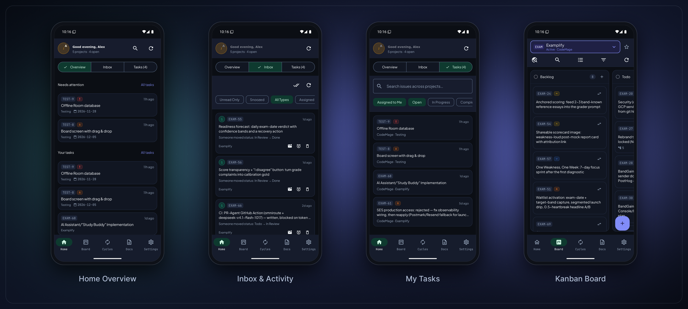

# It's a Plan for Android

An unofficial native Android client for [It's a Plan](https://github.com/croffasia/itsaplan),
a self-hosted, open-source project management and issue tracker. The app talks to your own
instance over its public REST API. No third-party servers, no telemetry, no dependency on the
official web client.

Kotlin and Jetpack Compose, with layouts for modern Android devices including book-style
foldables, where the unfolded screen shows two panes.

> Status: personal project, run against a real self-hosted instance. Expect rough edges.
> Not affiliated with, or endorsed by, the It's a Plan project or its maintainers.

<p align="center">
  
</p>

## Features

- Board: Kanban and grouped-list views of a project's issues, long-press drag-and-drop between
  Kanban columns, a quick-move status sheet, filters (priority, assignee, label, cycle), search,
  quick issue creation, and a recent-issues strip for jumping back into work.
- Issue detail: markdown-rendered description and comments, metadata editing (status, priority,
  assignee, AI delegate, type, cycle, due date, estimates), labels, custom fields, checklists,
  subtasks, linked issues, attachments from the photo/file picker, time tracking (worklogs),
  watch/unwatch, archive/restore/delete, AI agent run history, and linked pull requests and
  branches from connected Git providers (GitHub, GitLab, Gitea, Forgejo, Bitbucket). Images open
  in a full-screen viewer with pinch to zoom.
- Activity and comments: threaded comments with replies, emoji reactions, edit/delete, autosaved
  drafts, and one combined feed of comments, history and time logs with filtering.
- My Issues: cross-project list of issues assigned to or delegated to you, plus a home-screen
  widget showing your open issues.
- Global search: search issues across every accessible project from the Board tab.
- Inbox: notifications for assignments, mentions, comments, state changes and reactions, with
  read/unread, snooze and type filtering. Comment notifications deep-link to the comment and
  highlight it.
- Cycles: sprint-style time-boxed iterations. Create one, watch its progress, finish it, start the
  next, and carry unfinished issues over.
- Docs: browse a project's document tree, read rendered Markdown, and create or edit pages with
  autosaved drafts.
- Sharing: share issue and document links, or open them in a browser.
- Live sync: light polling of the server's revision endpoint refreshes the board and inbox when
  something changes elsewhere, without holding a real-time connection open.
- Responsive layout: bottom navigation bar on compact widths (phones, folded cover screens);
  navigation rail plus a list/detail split on medium and expanded widths (tablets, unfolded
  book-style foldables). Reading columns are width-capped so text does not stretch edge to edge on
  near-square unfolded displays.
- Auth: sign in with a personal API key, or with email/username and password (session cookie),
  against any HTTPS server URL you control. See
  [Connecting to a local-only instance](#connecting-to-a-local-only-instance).

## Screenshots

<p align="center">
  
</p>

<p align="center">
  
  
</p>

Real captures of every screen, in light and dark mode at phone width, live in
[`screenshots/`](screenshots/) and can be regenerated with
[`screenshots/capture.sh`](screenshots/capture.sh).

## Requirements

- An existing, reachable **self-hosted It's a Plan instance**. The
  [official project](https://github.com/croffasia/itsaplan) covers deployment. This app is a client
  only; it does not host or manage a server.
- A **personal API key** (Account settings → API keys on your instance) or a regular
  email/username and password login.
- Android 7.0 (API 24) or newer.

## Getting started

1. Clone this repository.
2. Open it in Android Studio, or build from the command line with Gradle (see below).
3. Build and install the app on a device or emulator.
4. On first launch, enter your It's a Plan server URL (e.g. `https://itsaplan.example.com`) and
   sign in with either a personal API key or your account credentials.

### Building

```bash
./gradlew assembleDebug
```

> This repository ships without a committed Gradle wrapper JAR. If `./gradlew` is not present,
> generate one locally with a matching Gradle installation (`gradle wrapper`) before building, or
> open the project in Android Studio, which bootstraps the wrapper for you.

### Configuration

You do not need build-time configuration to connect to a server. The server URL is entered at
runtime on the connect screen and stored on the device (see [Local storage and
privacy](#local-storage-and-privacy)). `.env.example` only documents an optional `GEMINI_API_KEY`
placeholder inherited from the AI Studio scaffold this project started from. The app's core
functionality does not use it, so you can ignore it.

### Connecting to a local-only instance

The app refuses plain HTTP for anything except the loopback and emulator hosts, because the
request carries your API key or session cookie:

| Address | Allowed |
| --- | --- |
| `https://…` | Yes, any host |
| `http://localhost`, `http://127.0.0.1`, `http://10.0.2.2` | Yes, local development and the Android emulator |
| `http://192.168.x.x`, `http://10.x.x.x`, any other `http://` | No |

That means a LAN-only instance served over plain HTTP, such as `http://192.168.1.5:3000`, is
rejected on purpose. Your options are:

1. **Give it TLS** (recommended). Put the instance behind a reverse proxy with a trusted
   certificate. Caddy, Traefik and nginx all obtain Let's Encrypt certificates automatically if
   the host is reachable from the internet, including through a dynamic-DNS name.
2. **Use a tunnel.** Cloudflare Tunnel, Tailscale Serve or ngrok expose the LAN instance on an
   `https://` address without opening a port or changing the server.
3. **Build your own APK** with a wider allowlist. Two places must agree:
   - `ApiClientManager.isLocalDevelopmentHost()` in
     `app/src/main/java/io/github/jontstaz/itsaplan/data/remote/ApiClientManager.kt`, which decides
     what the app will connect to;
   - `app/src/main/res/xml/network_security_config.xml`, which decides what Android permits. Add
     a `<domain>` entry per host. The platform config has no CIDR support, so private ranges have
     to be listed one by one.

Self-signed certificates are not trusted today. The app trusts the system CA store only, and from
API 24 onward Android does not treat user-installed CAs as system CAs. A self-signed instance
therefore needs either a publicly trusted certificate (options 1 and 2) or an APK built with
`<certificates src="user" />` added to that same file. That second option is a deliberate security
trade-off.

## Architecture

- UI: Jetpack Compose with Material 3, a single activity, and Compose Navigation driven by hand
  from in-memory state (no `navigation-compose` dependency).
- Networking: Retrofit and OkHttp, with Moshi for JSON. One `ApiClientManager` builds the
  authenticated OkHttp client (API key header or session cookie) against whichever server URL the
  user configured.
- State management: one `ViewModel` per feature area (`AppViewModel`, `IssueDetailViewModel`,
  `InboxViewModel`, `CyclesViewModel`, `MyIssuesViewModel`, `DocsViewModel`). Each exposes a
  single `StateFlow` of UI state, and repository calls come back as `Result`.
- Repository: `ItsAPlanRepository` is the one entry point to the API for every ViewModel. It turns
  raw HTTP calls into typed `Result<T>` values and keeps error parsing in one place.
- Persistence: `ConnectionStore` (DataStore Preferences) keeps the server URL, auth mode and
  credentials locally; `CryptoHelper` protects stored secrets at rest.
- Responsive layout: `androidx.compose.material3.windowsizeclass` computes the window size class
  from the Activity. `AppWindowSize` maps it to app-level breakpoints that drive the navigation
  rail versus bottom bar choice and the list/detail two-pane split (see
  `ui/layout/AppWindowSize.kt` and `ui/layout/AdaptiveLayout.kt`).

```
app/src/main/java/io/github/jontstaz/itsaplan/
├── data/
│   ├── local/        # ConnectionStore (DataStore), CryptoHelper
│   ├── model/         # API DTOs
│   ├── remote/        # Retrofit interface, ApiClientManager
│   └── repository/    # ItsAPlanRepository
├── ui/
│   ├── components/    # Shared composables (badges, avatars, chips, ...)
│   ├── layout/         # Window size class breakpoints, two-pane/list-detail helpers
│   ├── screens/        # One file (or group of files) per feature screen
│   ├── theme/          # Color, typography, theming
│   └── viewmodel/      # One ViewModel per feature area
└── MainActivity.kt
```

## Local storage and privacy

- The app stores your server URL and chosen credentials (API key or session cookie) on the device
  through Jetpack DataStore, encrypted at rest with `CryptoHelper`. Nothing leaves the device
  except requests to the self-hosted server URL you configure.
- No analytics, crash reporting or third-party telemetry SDKs are included.
- `android:allowBackup="false"` is set, so credentials stay out of Android's auto-backup.
- Plain HTTP is refused except for `localhost`, `127.0.0.1` and the emulator host `10.0.2.2`, so
  credentials are never sent unencrypted. Self-signed certificates are not trusted; see
  [Connecting to a local-only instance](#connecting-to-a-local-only-instance) for the
  alternatives.

## Known limitations

- Docs supports plain Markdown editing. It does not implement the collaborative
  rich-text/ProseMirror editing of the official web client.
- You cannot create pull requests or branches from the app. An issue shows only the pull requests
  and branches already linked to it, in a read-only "Development" section.
- Gradle wrapper binaries are not committed; see [Building](#building).
- Mostly tested against a single self-hosted instance. Features disabled per project on the server
  (Cycles, Docs and others) are respected where the API reports them, but this client does not
  expose every administrative feature of It's a Plan.

## Building a release

Release builds are signed with a local keystore that is deliberately not committed. Create
`signing.env` next to the project with:

```bash
export KEYSTORE_PATH="$PWD/my-upload-key-2026.jks"
export STORE_PASSWORD="…"
export KEY_PASSWORD="…"
```

Then:

```bash
source signing.env
./gradlew :app:assembleRelease
```

The signed APK lands at `app/build/outputs/apk/release/app-release.apk`. Keep the keystore and
passwords backed up. Android will not install an update signed with a different key, so losing
them means users have to uninstall and reinstall.

Releases 0.1.0 through 0.4.0 were signed with `my-upload-key.jks` (certificate digest
`1aeadb73…793e59`). 0.4.1 moved to `my-upload-key-2026.jks` (`f9816f7d…9080`), so anyone on 0.4.0
has to uninstall before installing 0.4.1 or later. Keep the old keystore around to sign nothing
further, but to prove which key produced those older files.

### Installing a sideloaded build

Release APKs are signed with a self-signed key, so Google Play Protect has no publisher record for
them. On a phone with Play Protect turned on, the installer can show a "Harmful app blocked"
dialog that calls the app fake. The build is the one published here; check your download against
the `.sha256` file that ships beside it before you continue.

Ways past the dialog:

- Tap `Install anyway`.
- Install over adb, which skips the on-device scan:

  ```bash
  adb install -r itsaplan-android-0.4.0.apk
  ```

- Turn off Settings → Google → Security → Google Play Protect → "Scan apps with Play Protect",
  install, turn it back on.

The verdict comes from a server-side reputation lookup keyed on package name and signing
certificate, so nothing inside the APK can change it. A newly introduced application id starts
with no history at all. If the older `com.aistudio.itsaplan.kvnqxp` build is still on the phone,
uninstall it first: two installed apps sharing one name and icon is the shape of a repackaged
clone, which is what that check looks for. To get the warning cleared for real, report it as a
false positive through the "Learn more" link in the dialog, with the package name, the sha256 of
the APK, and the signing certificate digest (`f9816f7d…9080`). Keeping the application id stable
from then on keeps that history intact.

## Contributing

Issues and pull requests are welcome. This is a small side project, so keep changes focused and
consistent with the Compose/MVVM structure described above.

## Credits

- [It's a Plan](https://github.com/croffasia/itsaplan) is the self-hosted project this app is a
  client for. Project management, issue tracking and AI agent functionality all live on your own
  server; this app is a mobile window into it.
- [compose-markdown](https://github.com/jeziellago/compose-markdown) renders Markdown for issue
  descriptions, comments and Docs pages.

## License

[MIT](LICENSE) © 2026 jontstaz.

This project is not affiliated with, endorsed by, or sponsored by the It's a Plan project.